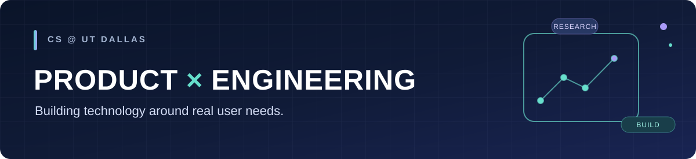

<h1 align="center">Hi, I'm Arthur Holobaugh.</h1>

<strong>Computer Science @ UT Dallas</strong>

  
  
  

  Product-minded developer building software that makes complex decisions simpler.

  Interested in frontend development, product management, and creating intuitive digital experiences.

  <a href="https://www.linkedin.com/in/arthurholobaugh/">LinkedIn</a>
  &nbsp;·&nbsp;
  <a href="https://github.com/arthurholobaugh?tab=repositories">Projects</a>
  &nbsp;·&nbsp;
  <a href="mailto:arthurholobaugh@gmail.com">Contact</a>

---

## Featured Projects

A selection of projects at the intersection of software development, product thinking, and user experience.

### [MarketLens](https://github.com/arthurholobaugh/marketlens)  
 
AI-powered product intelligence platform in development, designed to help Amazon sellers evaluate demand, competition, profitability, and launch risks.

**Tech:** Python & JavaScript; React/Streamlit, FastAPI, and machine learning *(planned)*

### [Shopping Hub](https://github.com/arthurholobaugh/ShoppingHub)  
 
Accessible shopping experience focused on intuitive product discovery, side-by-side comparison, and informed buying decisions.

**Tech:** React · JavaScript · Vite

### [Nebula Labs](https://github.com/UTDNebula)  
 
Involved with Nebula Labs, a UT Dallas student organization developing software for students. Explore projects such as [UTD Clubs](https://github.com/UTDNebula/utd-clubs) and [Skedge](https://github.com/UTDNebula/skedge).

**Project tech:** Next.js · TypeScript · React

---

## Technical Skills

  

**Programming:** `Java` · `Python` · `JavaScript` · `C++` · `SQL` · `HTML`

**Frontend:** `React` · `Vite`

**Data & AI:** `Pandas` · `Scikit-learn` · `XGBoost`

**Design & Development:** `Figma` · `FigJam` · `Git` · `GitHub` · `VS Code`

## Product Management

   

- **Product Discovery:** User Research · Customer Interviews · Needfinding · Market Research
- **Strategy & Planning:** Product Strategy · Requirements Gathering · Feature Prioritization · Agile Methodologies
- **Design & Validation:** UI/UX Prototyping · Usability Testing
- **Collaboration & Decisions:** Cross-functional Collaboration · Stakeholder Communication · Data-driven Decision Making

