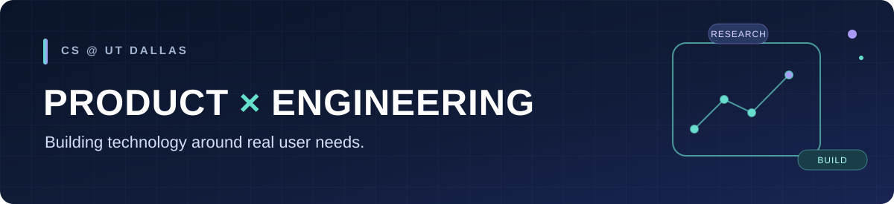

<h1 align="center">Hi, I'm Arthur Holobaugh.</h1>

<strong>Computer Science @ UT Dallas</strong>

  
  
  

  Computer science student interested in the intersection of technology, business strategy, and product development.

  Passionate about understanding user needs, solving real-world problems, and building products that make a difference.

  <a href="https://www.linkedin.com/in/arthurholobaugh/">LinkedIn</a>
  &nbsp;·&nbsp;
  <a href="https://github.com/arthurholobaugh?tab=repositories">Projects</a>
  &nbsp;·&nbsp;
  <a href="mailto:arthurholobaugh@gmail.com">Contact</a>

---

## Featured Projects

A selection of projects at the intersection of software development, product thinking, and user experience.

### [MarketLens](https://github.com/arthurholobaugh/marketlens)  
 

MarketLens helps Amazon sellers make more informed product launch decisions by bringing market analysis, AI-powered opportunity scoring, and financial forecasting into one platform. It helps users evaluate product potential, compare opportunities, and explore projected sales and profitability before committing resources.

**Product value:** Smarter product selection · Clearer financial planning · More confident launch decisions

**Tech:** React · JavaScript · Python · FastAPI · XGBoost · Firebase

### Artificial Intelligence Society (AIS) | UT Dallas  
 

Through the Artificial Intelligence Society at UT Dallas, I collaborate on projects that explore how AI can solve business problems and support better decision-making. My work on MarketLens focuses on connecting market analysis, financial forecasting, and product strategy to help businesses evaluate new opportunities.

**Focus:** Business Intelligence · Product Strategy · AI-Driven Decision-Making

### [Nebula Labs](https://github.com/UTDNebula)  
 

As a product manager at Nebula Labs, a student-run organization at UT Dallas, I collaborate with engineering and design teams to develop digital products for the university community. My work focuses on identifying user needs, evaluating product opportunities, prioritizing features, and aligning product decisions with user impact and technical feasibility.

**Focus:** Product Strategy · Feature Prioritization · Cross-functional Collaboration

**Projects:** [UTD Trends](https://github.com/UTDNebula/utd-trends) · [UTD Clubs](https://github.com/UTDNebula/utd-clubs)

---

## Technical Skills

  

**Programming:** `Java` · `Python` · `JavaScript` · `C++` · `SQL` · `HTML`

**Frontend:** `React` · `Vite`

**Data & AI:** `Pandas` · `Scikit-learn` · `XGBoost`

**Design & Development:** `Figma` · `FigJam` · `Git` · `GitHub` · `VS Code`

## Product Management

- **Product Discovery:** User Research · Market Research · Problem Identification · Opportunity Assessment
- **Strategy & Planning:** Product Strategy · Requirements Gathering · Feature Prioritization · Roadmapping
- **Product Development:** Prototyping · User Feedback · Usability Evaluation · Iterative Improvement
- **Collaboration & Decision-Making:** Cross-functional Collaboration · Stakeholder Communication · Data-driven Decision Making

